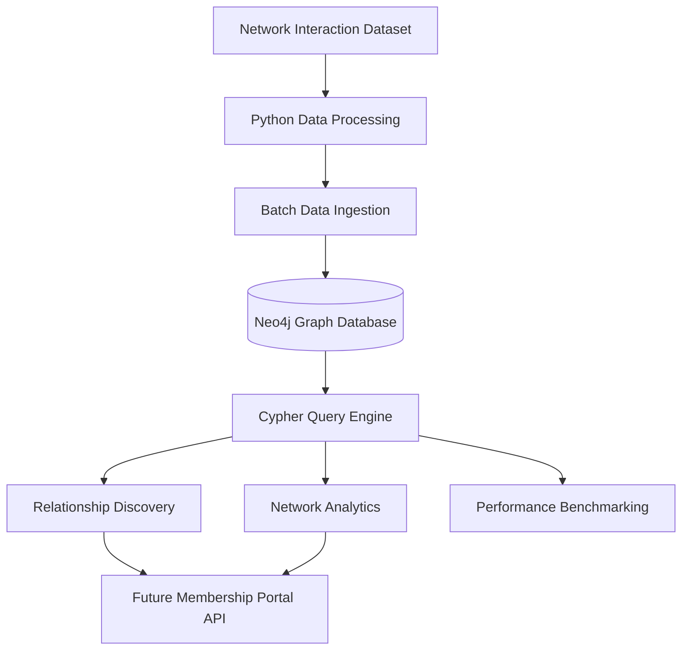
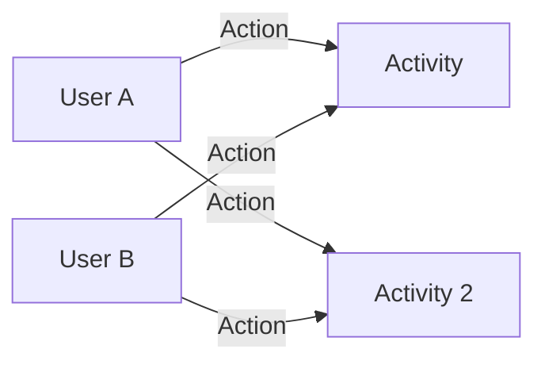
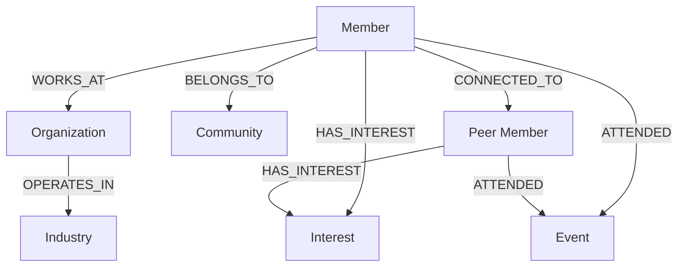
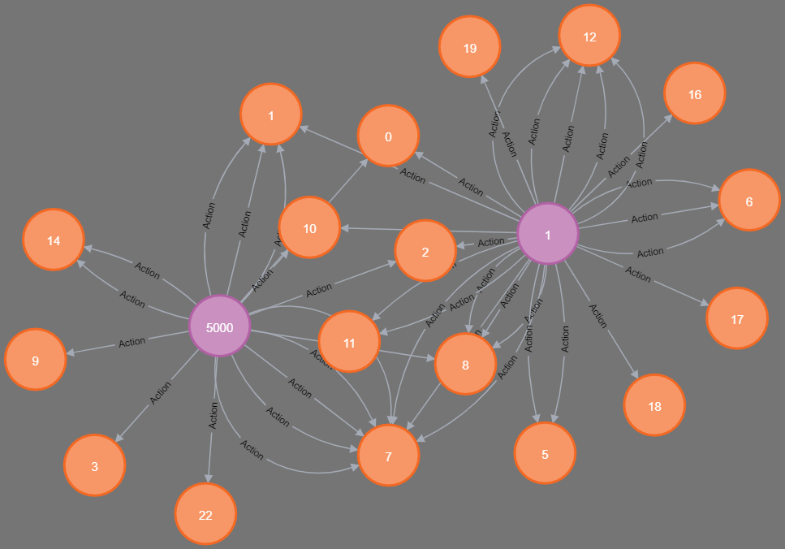

# Meridian Relationship Atlas

A graph-based relationship discovery and network analytics platform built with Python, Neo4j, and Cypher.

## Overview

Meridian Relationship Atlas explores how graph database technology can power member discovery, relationship exploration, and personalized recommendations within professional networking communities.

The project provides a foundation for building membership platforms where users can discover relevant peers, explore shared interests, identify common activities, and build meaningful professional connections.

Using Neo4j, the platform models complex relationships as a connected graph rather than relying exclusively on traditional relational database joins.

## Key Features

- Graph-based member and activity modeling
- Relationship discovery and network traversal
- Large-scale interaction data ingestion
- Cypher query execution and performance benchmarking
- Batch processing and transaction management
- Database indexing and uniqueness constraints
- Temporal interaction analysis
- Anonymized user data processing
- Extensible foundation for member recommendations

## Use Cases

The graph architecture can be extended to support:

- Professional membership portals
- Executive networking communities
- Member directory and peer discovery
- Shared-interest recommendations
- Community and chapter discovery
- Event-based networking
- Member engagement analytics
- AI-powered knowledge and relationship discovery

## Technology Stack

| Component | Technology |
|---|---|
| Programming Language | Python 3.x |
| Graph Database | Neo4j |
| Query Language | Cypher |
| Database Connectivity | Neo4j Python Driver |
| Data Processing | Python, CSV, TSV |
| Performance Analysis | Neo4j Query Statistics |
| Data Ingestion | Batch Transactions, LOAD CSV |

## System Architecture



## Graph Data Model

The current implementation represents users, activities, and their interactions as a connected graph.

### Current Graph Model



| Entity | Description |
|---|---|
| User | An anonymized network participant |
| Target | An activity or interaction destination |
| Action | A timestamped interaction between a user and a target |

### Proposed Membership Graph Model

For a professional membership platform, the existing graph model can be extended to include:



This structure would support multi-hop relationship queries, shared-interest discovery, professional recommendations, and community exploration.

## Relationship Discovery

Graph traversal makes it possible to discover users who interact with similar activities without requiring complex relational joins.

The following example illustrates how shared activities could be used to identify relevant peers using the existing graph model:

```cypher
MATCH (u:User {id: $userId})-[:Action]->(t:Target)
      <-[:Action]-(peer:User)
WHERE peer <> u
WITH peer, count(DISTINCT t) AS sharedActivities
RETURN peer.id AS peerId, sharedActivities
ORDER BY sharedActivities DESC
LIMIT 20
```

For an extended membership graph, shared interests could support more personalized member recommendations:

```cypher
MATCH (m:Member {id: $memberId})
      -[:HAS_INTEREST]->(i:Interest)
      <-[:HAS_INTEREST]-(peer:Member)
WHERE peer <> m
WITH peer, collect(DISTINCT i.name) AS sharedInterests
WHERE size(sharedInterests) >= 2
RETURN peer.id AS memberId,
       peer.name AS memberName,
       sharedInterests,
       size(sharedInterests) AS relevanceScore
ORDER BY relevanceScore DESC
LIMIT 20
```

The second query is an illustrative example for the proposed membership schema, not part of the current dataset implementation.

## Dataset

The project uses the User Action Dataset as an anonymized network interaction dataset for validating graph modeling, relationship traversal, and ingestion performance.

Although the source dataset represents online learning interactions, its connected structure provides a useful test environment for membership and community engagement applications.

### Dataset Statistics

| Metric | Value |
|---|---:|
| Network Participants | 7,047 |
| Activity Targets | 97 |
| Recorded Interactions | 411,749 |
| Positive Dropout Labels | 4,066 |
| Timestamp Resolution | Seconds |

### Dataset Files

| File | Description |
|---|---|
| `mooc_actions.tsv` | Time-ordered user interactions |
| `mooc_action_features.tsv` | Interaction-level attributes |
| `mooc_action_labels.tsv` | Binary dropout labels |

### Graph Visualization



Purple nodes represent network participants, orange nodes represent activity targets, and relationships represent recorded interactions.

## Repository Structure

```text
meridian-relationship-atlas/
├── act-mooc/
│   ├── mooc_actions.tsv
│   ├── mooc_action_features.tsv
│   └── mooc_action_labels.tsv
├── misc/
│   └── graph.png
├── graphdb.py
├── createGraphDB.py
├── loadData.py
├── queries.py
├── bulk-insert-actions.cypher
├── queries.cypher
├── indices.cypher
├── constraints.cypher
└── README.md
```

## Core Components

### Database Connectivity

`graphdb.py`

Manages Neo4j database connections, query execution, batch operations, and driver lifecycle management.

### Graph Initialization

`createGraphDB.py`

Initializes the graph database, creates user and activity nodes, and configures indexes for efficient relationship creation.

### Data Processing

`loadData.py`

Processes raw interaction datasets, transforms records into graph-compatible structures, and generates CSV files and Cypher statements for ingestion.

### Query Execution and Benchmarking

`queries.py`

Executes graph queries and collects database timing statistics using the Neo4j result summary.

### Bulk Relationship Ingestion

`bulk-insert-actions.cypher`

Imports interaction relationships using CSV-based ingestion and transactional processing.

### Database Optimization

`indices.cypher` and `constraints.cypher`

Configure indexes and uniqueness constraints to support efficient node lookup, relationship creation, and data integrity.

## Getting Started

### Prerequisites

- Python 3.x
- Neo4j Database
- Neo4j Python Driver

### Install Dependencies

```bash
pip install neo4j
```

### Configure Neo4j

Start a local Neo4j instance and configure the database connection settings in the Python scripts.

```text
URI: bolt://localhost:7687
Username: neo4j
Password: your-local-password
```

For production environments, credentials should be managed through environment variables or a secure secrets manager rather than hardcoded in source files.

### Initialize the Graph

```bash
python createGraphDB.py
```

This creates the user and activity nodes and initializes the indexes required for relationship ingestion.

### Load Relationships

The project supports two ingestion strategies.

**Python batch ingestion**

Set `createRelationshipsFromPython` to `True` in `createGraphDB.py` to insert relationships through batched database transactions.

**Cypher bulk ingestion**

Set `createRelationshipsFromPython` to `False` to generate the `actions.csv` file.

Move the generated CSV file into the Neo4j import directory and execute:

```text
bulk-insert-actions.cypher
```

CSV-based bulk ingestion is generally more efficient for large interaction datasets.

### Execute Queries

```bash
python queries.py
```

Additional graph queries can be executed through Neo4j Browser using `queries.cypher`.

## Performance and Scalability

The project explores several approaches to improving graph database performance:

- Indexed node lookups
- Uniqueness constraints
- Batch transaction processing
- CSV-based relationship ingestion
- Efficient graph traversal
- Query execution benchmarking
- Reduced database round trips

Neo4j's `EXPLAIN` and `PROFILE` commands can also be used to inspect execution plans and identify expensive graph operations.

## Privacy and Security Considerations

The current implementation uses anonymized interaction data.

A production membership platform would additionally require:

- Authentication and role-based authorization
- Member-level visibility controls
- Permission-aware graph traversal
- Field-level access restrictions
- Parameterized Cypher queries
- Secure credential management
- Audit logging
- Membership-scoped data retrieval

These controls should be enforced at the API and database query layers rather than relying solely on frontend restrictions.

## Future Development

The project is designed as a foundation for a more comprehensive professional networking and membership platform.

### Membership Portal

- React and TypeScript frontend
- Member profiles and searchable directory
- Community and event discovery
- Interactive relationship visualization

### GraphQL API

- Node.js and Apollo Server
- GraphQL schemas and resolvers
- Neo4j GraphQL integration
- Cursor-based pagination
- DataLoader and Redis caching
- Field-level authorization

### AI-Powered Member Discovery

- Natural-language member search
- OpenAI embeddings
- Neo4j vector search
- Graph-based retrieval-augmented generation
- Personalized peer recommendations
- Permission-aware context retrieval
- Source-grounded AI responses

### Production Infrastructure

- Docker containerization
- Automated testing
- GitHub Actions CI/CD
- Cloud deployment
- Application monitoring and observability

## Project Status

The current implementation focuses on graph database initialization, large-scale interaction ingestion, Cypher queries, and network performance analysis.

The membership portal, GraphQL API, and AI-powered discovery capabilities represent proposed extensions to the existing graph analytics foundation.

---

Meridian Relationship Atlas — Exploring connected data to enable meaningful professional relationships.
